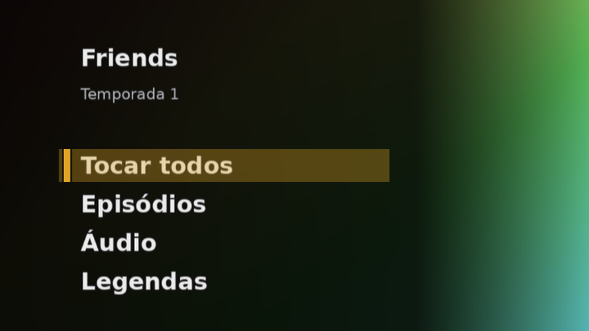
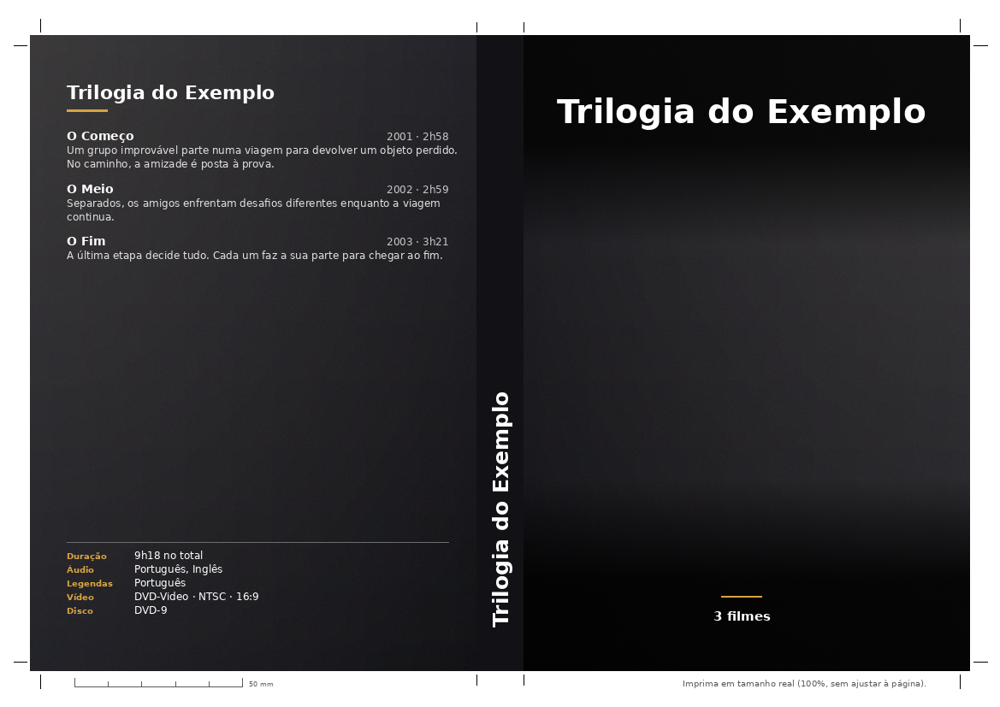

# projeto-dvd

[](https://github.com/vinivaliati/projeto-dvd/actions/workflows/ci.yml)

**English** | [Português](README.pt-BR.md)

A local web app that turns a personal movie and TV collection into **authored DVD and Blu-ray
discs with navigable menus**, plus **printable covers** for the cases.

The goal is a physical collection meant to last: discs that follow the official DVD-Video and
BDMV specifications closely enough to play on an ordinary player 20 years from now, with menus
simple enough for a child or a grandparent to use with just the remote.

> **Status:** Phase 5 (printable cover and disc labels) on top of the DVD with menus of
> Phases 4a and 4b. Each video of a disc folder is matched with TMDB (movie or episode, pt-BR
> data and art), the whole folder becomes a DVD-Video ISO with menus, checked automatically,
> and the **Capa** page prints the case insert and two round labels on A4. See the roadmap in
> [`CLAUDE.md`](CLAUDE.md) (in Portuguese).

## Planned pipeline

```
scan → probe → match metadata (TMDB) → disc project (DVD-5/9, BD-25/50) → encode → menu → authoring → ISO
```

The app produces an `.iso` file. Burning happens on Windows (ImgBurn or the built-in burner),
because WSL cannot access the optical drive.

## How the input folder works

One subfolder of the input folder is one disc. Put the videos of each disc in its own
subfolder; the app never walks the whole drive.

```
entrada\                          (HOST_MEDIA_DIR, mounted read-only at /media)
  Senhor dos Aneis\               → 1 folder = 1 disc
    A Sociedade do Anel.mkv
    As Duas Torres.mkv
    O Retorno do Rei.mkv
    O Retorno do Rei.pt-BR.srt    → external subtitle of the video above
  Friends T1\
    Temporada 1\S01E01.mkv        → subfolders inside a disc folder are allowed
```

- Videos: `.mkv`, `.mp4`, `.m4v`, `.avi`, `.mov`, `.ts`, `.m2ts`.
- External subtitles: `.srt`, `.ass`, `.ssa`, `.sup`, and `.idx` next to its `.sub`. A
  subtitle belongs to the video whose name starts it (`Movie.pt-BR.srt` → `Movie.mkv`); when
  several match, the longest name wins (`Movie.2.pt.srt` → `Movie.2.mkv`).
- Videos placed directly in the input folder, outside a disc folder, are not listed. Symbolic
  links are ignored.
- Use one video file per title (for example an `.mkv` made with MakeMKV). Copied disc folders
  (`VIDEO_TS`, `BDMV`) are not supported: their `.VOB` files are skipped and a full `BDMV` would list
  every clip.
- Rescans are incremental: a file is read again only when its size or modification time
  changes.
- The input folder can be on `C:` or on the external drive itself. Copying to `C:` takes space
  (a Blu-ray movie is 30 to 50 GB).

## Matching with TMDB

The menus and covers of the next phases need to know which movie or episode each video is. The
app finds it on [TMDB](https://www.themoviedb.org/) and the Vini confirms it.

1. Create a free TMDB account, open Settings > API and copy the **API Read Access Token** (the
   long one). Put it in `.env` as `TMDB_TOKEN=...` and run `docker compose up -d`. Without a
   token the folder page explains this and everything else works.
2. On a scanned folder, click **Buscar no TMDB**. Each video gets a card with a suggestion from
   its file name (release names, `S01E03`, `1x03`, `T01E03`, `Temporada 2/03.mkv`, MakeMKV
   `title_t00.mkv`...). A name that says nothing falls back to the folder name.
3. A **Sugestão** is an exact title (and year) match; **Confira** marks what is ambiguous (two
   movies with the same name, a 20-minute file suggested as a movie, an episode TMDB does not
   have). **Confirmar todas as sugestões** confirms only the sure ones; **Corrigir** searches
   by hand (movie or series, season and episode).
4. Confirming saves the pt-BR data (English when there is no translation) and downloads the
   default art: `HOST_OUTPUT_DIR\covers\<folder>\<Title (year)>\poster.jpg`, `backdrop.jpg`,
   `logo.png` and `metadata.json` (episodes: `S01E03.jpg` and `S01E03.json` in the series
   folder). Choosing among several images comes with the covers.

The "Montar DVD" page then uses the TMDB names in the menu, the backdrop as the menu art and
the original language to suggest the audio.


This product uses the TMDB API but is not endorsed or certified by TMDB. The data and images
are used for personal, non-commercial purposes (printing covers of one's own collection).

## Building a DVD



1. Put the videos of one disc in a folder (three movies, or the episodes of a season), open the
   folder in the app and click **Escanear**.
2. Click **Montar DVD**. The page already suggests everything and saves each change:
   - **Titles:** movies or a series, in the order of the disc (move them up and down). Names
     come from TMDB when the match is confirmed, or from the file name.
   - **Languages, for the whole disc:** audio and subtitle languages, which audio plays first
     and which subtitle starts on. Each title gets its best track of each language; a title
     that lacks one is listed (it plays its own first track, or no subtitle). Compatible AC-3
     is copied without loss; anything else becomes AC-3, never inventing channels. Text
     subtitles (`.srt` or a text track of the MKV) become DVD subtitles.
   - **Menu:** a live preview of each page, with the backdrop (from TMDB or a dark one), the
     accent color (from a closed palette, or picked from the backdrop) and the side of the
     buttons.
   - **Chapters:** from the file, or every N minutes (99 per title at most).
   - **Disc:** DVD-5 or DVD-9, each card with the size and the picture quality of the whole
     disc ("Ótima", "Aceitável", "Baixa" asks for a confirmation, "Não cabe"). Every title gets
     the same video bitrate, so the quality is the same from the first to the last.
3. The job page shows the steps of the current title, the progress and the time left; you can
   close it and come back from **Jobs**.
4. The ISO is checked automatically (size, VIDEO_TS structure, and for every title and menu
   page the streams, languages, chapters, field order, audio sync and a full decode). Only an
   approved ISO is copied to `HOST_OUTPUT_DIR\iso\<folder>.iso`.
5. Test the ISO in VLC (Media, Open Disc) with the checklist on the job page, then burn it on
   Windows with ImgBurn ("Write image file to disc", low speed, verify).

**On the disc:** inserting it opens the main menu. A movie disc lists the movies (more than six
get their own pages); a series disc has "Tocar todos", the episode pages (an episode keeps
playing until the end of the disc) and the language pages. "Áudio" and "Legendas" are pages
of their own with a check mark on the language that is on. A movie returns to its own page and
button; the Menu and Title keys of the remote always go back to the main menu.

**Resume, the cache and DVD rips:**

- **Resume:** a job that stopped in the middle (WSL or the PC restarted, no space, canceled)
  has a **Retomar** button. It runs the same plan again, and the titles already encoded come
  from the cache.
- **Cache:** the MPEG-2 video of each encoded title stays in `HOST_WORK_DIR/cache` (a hard
  link, no copy), keyed by the encode command itself. Rebuilding a disc with another menu,
  order or chapters skips the encode. The oldest entries leave above `CACHE_LIMIT_GB`
  (default 50; 0 turns it off); the Jobs page shows the size and cleans it.
- **DVD rips:** the MPEG-2 video of a DVD rip (720x480 with the DVD sequence header) is copied
  byte for byte instead of encoded again, when the chosen audio fits the room the original disc
  had. Its chapters are the ones of the rip, moved to the nearest closed GOP; the job checks the
  stream right after extracting it, and the QA checks the video on the disc is identical. "Recodificar
  os rips" turns it off for a disc.

How it works, briefly:

- **Video:** MPEG-2 in two passes (never `-target ntsc-dvd`, which duplicates frames);
  23.976 fps films get **soft pulldown** by a small in-place patcher; 480i sources stay
  interlaced; DVD rips are classified by their frames.
- **Menus:** drawn with Pillow in square pixels and squeezed to 720x480; the button highlight
  is a 4-color subpicture drawn straight at 720x480 (no antialias). A 16:9 menu has a second
  button stream for 4:3 TVs that letterbox it. Each page is one second of still MPEG-2 with
  silent AC-3.
- **Navigation:** `dvdauthor` with one titleset per title (each declares exactly its own
  tracks) and every jump through the VMGM, where three command-only PGCs open the main page,
  dispatch the next title and show the page the viewer was on. GPRMs keep the languages, the next episode and the highlighted
  button. A disc takes up to 60 titles (the dispatcher fits in the 128 commands of one PGC).
- **ISO:** `genisoimage -dvd-video -udf`.
- **Tests:** the slow tests author real discs and drive them with libdvdnav, the navigation
  library of VLC (a physical player is still the final test).

**Not supported yet** (the screen explains why): HDR and 4K, PAL/25 fps, exact 24 fps, 29.97
progressive, 59.94, variable frame rate, 1080i, image subtitles (PGS, VobSub) and ASS styling,
chapter menus and video menus. For a movie whose Portuguese subtitle is an image, put an `.srt`
next to it.

The work folder needs about **three times the disc size** free with the cache on (about 27 GB
for a DVD-9; twice without it): each intermediate file is deleted as soon as the next step
succeeds, and **Apagar arquivos temporários** on the job page removes what is left.

## Printing the cover

The **Capa** button of a folder opens the cover of the disc it builds (it reads what the
Montar DVD page saved: titles, languages, backdrop and accent color).



- **Case insert** for a standard DVD case (Amaray, 273 x 183 mm with a 14 mm spine) on an A4
  sheet turned sideways, with 3 mm of bleed, crop marks, fold marks for the spine and a 50 mm
  ruler. **Front:** the chosen art, the name and a line such as "3 filmes" or "Temporada 1 · 8
  episódios". **Spine:** the name read from the bottom up, plus the year or "T1". **Back:** the
  synopsis and cast of a movie, the list of movies or episodes with their real durations, and a
  technical box (duration, audio, subtitles, video, disc).
- **Disc labels:** a second A4 page with two round labels (117 mm, 41 mm hole, the common
  Pimaco layout), with the menu backdrop cut in a ring.
- **Art:** a grid with every poster and backdrop TMDB sent for the confirmed titles (the season
  or collection poster first), with a badge when an image would print below 300 DPI. The chosen
  one is downloaded once to `OUTPUT_DIR/covers/<folder>/`. A poster that already shows its
  title gets no name on top (automatic, can be changed).
- **Print:** "Gerar PDF" writes `OUTPUT_DIR/print/<folder>.pdf` (300 DPI, sRGB). Print it at
  **actual size** (100%, no "fit to page"), check the 50 mm ruler with a ruler, cut on the
  marks and fold on the spine marks. The measures live in `covers/sizes.py`: check them against
  the case and the label sheet you bought before printing a batch.

## Stack

- Python 3.12, FastAPI, Jinja2, HTMX and a small hand-written CSS (no build step)
- httpx2 for the TMDB API (and its `MockTransport` in the tests: they never call TMDB)
- Pillow for the menu pages, the covers and their PDF
- SQLite (WAL) with SQLModel and Alembic; a separate worker process runs the jobs
- Media toolchain: ffmpeg, dvdauthor/spumux, genisoimage, tsMuxeR, xorriso
- Docker and docker compose; GitHub Actions CI
- uv, ruff, mypy (strict), pytest

## Running with Docker

Requirements: Docker (on Windows, Docker Desktop with WSL integration enabled).

```bash
cp .env.example .env   # then edit the three host paths
# Docker would create missing folders as root; the subshell keeps .env out of your shell.
(set -a; . ./.env; mkdir -p "$HOST_WORK_DIR" "$HOST_OUTPUT_DIR")
make dev               # docker compose up --build
```

The input folder (`HOST_MEDIA_DIR`) is not created for you: create it with one subfolder per
disc, and if it lives on the external drive, connect the drive before `make dev`. Otherwise
Docker mounts an empty folder and the library shows no discs.

Open <http://localhost:8000>. <http://localhost:8000/health> lists the media tool versions found
in the container and returns 503 if any of them is missing.

The input folder is mounted **read-only**: the app never modifies the original files.

Two services run: `web` (the pages) and `worker` (one DVD job at a time). `docker compose logs
worker` shows what the worker is doing; `docker compose stop` stops the running encode within a
few seconds and marks the job as failed (generate it again). The app answers only on
`localhost`/`127.0.0.1` and refuses state-changing requests sent by other sites.

The scan results are kept in a SQLite database in the `data` Docker volume, so they survive
rebuilds. `docker compose down -v` erases that volume (the scan cache only, never the media);
the next scan reads everything again.

## Development

Requirements: [uv](https://docs.astral.sh/uv/).

| Command | What it does |
|---|---|
| `make test` | Run the unit tests with coverage (minimum 90%) |
| `make test-slow` | Run the integration tests inside the Docker image, with the real ffmpeg and no network |
| `make lint` | ruff lint, ruff format check, mypy strict |
| `make format` | Format and auto-fix with ruff |
| `make fixtures` | Regenerate the ffprobe JSON fixtures with the ffmpeg pinned in the image |
| `make dev` | Build and start the app with docker compose |

To generate a disc from the terminal with the suggested choices (development and debugging):

```bash
docker compose run --rm worker python -m projeto_dvd.jobs.pipeline "Folder name"
```

To run the app without Docker (needs `ffprobe` on the `PATH` to scan):

```bash
MEDIA_DIR=/path/to/entrada DATABASE_URL=sqlite:///./projeto_dvd.db \
  uv run uvicorn projeto_dvd.app:create_app --factory
```

## Maintenance

- The media toolchain is pinned (base image digest, Debian package versions, tsMuxeR checksum).
  When Debian ships a security update the build breaks on purpose; update the pins in the
  `Dockerfile` and commit. After an ffmpeg update, run `make test-slow`: it compares the
  committed fixtures with the new ffprobe output. The Dolby Vision profile 5 fixture is
  hand-written: also check that ffprobe still names its side data "DOVI configuration record".
- The DVD subtitles use the DejaVu Sans font of the image (`fonts-dejavu-core`, pinned). The
  soft pulldown patcher leaves the GOP `time_code` on a 24p scale; players ignore it, but
  confirm on the first physical player test.
- tsMuxeR has low upstream activity. Keep a copy of
  `tsMuxer-2.7.0-linux.zip` (sha256 `ceaaa181ab70e201685b1e45260d337d1cbdb0aba1408d4fbc47e232a7e4c987`)
  outside GitHub.
- HTMX 2.0.11 is vendored at `src/projeto_dvd/web/static/htmx.min.js` (source
  `https://unpkg.com/htmx.org@2.0.11/dist/htmx.min.js`, sha256
  `d6fdc75f204e6bdefa99b69bf1e6d4ac69b8a364f77929f45c13476b4000f717`).

- The TMDB logo in the footer is `src/projeto_dvd/web/static/tmdb.svg`, their "blue short"
  logo from https://www.themoviedb.org/about/logos-attribution (sha256
  `8e7b30f73a4020692ccca9c88bafe5dcb6f8a62a4c6bc55cd9ba82bb2cd95f6c`).

## License

[MIT](LICENSE)
